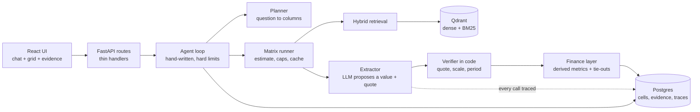

# Tessera

A financial research workbench for private equity and credit diligence. Ask a question about public companies and Tessera builds a matrix of **companies x typed questions**, fills every cell from the companies' own filings, and writes the answer from those cells.

Every number is tied to a **verbatim quote** that is checked in code, and it carries its period, units and currency. Derived metrics (net debt, interest coverage) and tie-out checks are computed in code, never by the model. When the documents do not say, the cell says so.


## Why it is not a chatbot over a table

| Rule | How it is enforced |
|---|---|
| Never answer from memory | Cell values come from retrieved document text only. Document text is fenced as data and can never trigger a tool call. |
| Every answer is cited | A quote must appear verbatim in the cited source, or the cell is not `answered`. |
| Numbers carry period, units, currency | Scale (`$1.2B`, `402 million`) is parsed in code. An answer that drops a scale printed in its quote is refused. A period must appear in the text it came from. |
| The model does not do arithmetic | Net debt, interest coverage, margins and growth are computed in code from other cells, and refuse mixed currencies, mixed periods and zero divisors. |
| Checks are shown, not hidden | Tie-outs (such as gross profit = revenue minus cost) run in code and a failure is shown on the cell with the gap. |
| "Not applicable" is not "not found" | They are separate cell statuses and are never merged. |
| Costs are bounded | A cost estimate and a confirmation come before a run. Hard step, time and cost limits apply per turn and per session. |

The pattern throughout: **the model proposes, code decides.**

## How it works

1. **Attach a filing.** Intake identifies the company (name, ticker, domain) and finds or creates its row.
2. **Ask a question.** "How leveraged are Palantir and Apple?" becomes a **plan card**: which columns, which are computed, and what it will cost.

   

3. **Confirm.** Cells are filled with hybrid retrieval (BM25 plus dense vectors, fused with RRF), extraction with quote verification, then computed cells and tie-outs.
4. **Read the answer.** The chat answer is written from the cells, with `[Row · Column]` citations. Click any cell to see its status, reason and verbatim quote.

   

   The `Not found` above is the intended behaviour. Apple's filing never states a total debt figure, and the tool says what would have to be summed instead of inventing a number.

## Architecture



- **Domain pack.** A JSON file of typed columns, applicability rules, derived metrics and tie-out checks ([credit_pe_diligence.json](backend/app/packs/data/credit_pe_diligence.json), 26 columns). A new pack needs no new logic.
- **Agent.** A hand-written loop, with a tool registry of Pydantic-typed tools. Costly or destructive actions (remove a row, overwrite a human-edited cell) are stored as pending actions and run only after the user confirms.
- **Tracing.** One row per LLM call: request id, model, prompt version, tokens in and out, cost, latency, status. Results are cached.
- **Export.** The grid exports to PDF with a Sources appendix.

## Stack

Python 3.14, FastAPI, Pydantic v2, asyncpg and Postgres, Qdrant, fastembed (BM25), LangChain model adapters, OpenRouter, pytest, ruff, mypy. React 19, TypeScript, Vite, Tailwind, TanStack Table, vitest.

## Run it with Docker

```bash
cp .env.example .env        # set OPENROUTER_API_KEY (the compose file supplies the database settings)
docker compose up --build
```

Then open http://localhost:5173. Compose starts Postgres, Qdrant, the API (which applies the migrations on start) and the web app. Data is kept in named volumes, so it survives a restart; `docker compose down -v` wipes it.

## Run it locally

Requirements: Python 3.14 with [uv](https://docs.astral.sh/uv/), Node 20+, Postgres, an OpenRouter key.

```bash
# 1. configure (secrets come only from the environment)
cp .env.example .env          # set OPENROUTER_API_KEY and DATABASE_URL

# 2. database
uv run python -m backend.app.db.migrate

# 3. backend
uv run uvicorn backend.app.main:app --port 8000

# 4. frontend
cd frontend && npm install && npm run dev      # http://localhost:5173
```

Vectors live in a local folder (`data/qdrant`) unless `QDRANT_URL` is set.

## Design decisions

Each entry: what was chosen, what it was chosen over, and why.

- **Finance only, PE and credit diligence first.** Over a multi-industry tool. Typed finance questions let correctness be checked in code (periods, units, tie-outs). Generic questions can only be judged by reading. Other uses (bank, fintech) come as data packs, not new logic.
- **The model proposes, code decides.** The model suggests a value, a quote, a period or a column. Code verifies the quote against the source text, parses the scale, checks that the period appears in the text, and validates the plan. Over trusting structured output: a well-formed answer can still be wrong.
- **Derived numbers are computed in code.** Net debt, margins, growth and coverage are formulas over other cells, with the inputs' quotes attached. Over asking the model: arithmetic from a model is not reproducible, and a mixed-period or mixed-currency input must be refused, not averaged.
- **Tie-outs are visible, not silent.** A failed check (such as gross profit versus revenue minus cost) is shown on the cell with the gap. Over hiding it or auto-correcting: companies define some figures differently, and the reader should see that.
- **`not applicable` and `not found` are different statuses.** One means the question does not apply to the company. The other means it applies and the documents do not answer it. Merging them would make an absent answer look like a negative one.
- **Hybrid retrieval, Postgres plus Qdrant.** Dense vectors and BM25 are fused with reciprocal rank fusion, over vectors alone. Filings are full of exact terms (line-item names, defined terms) that keyword search finds and embeddings blur. Postgres stays the source of truth and Qdrant is an index.
- **A hand-written agent loop with hard limits, not an agent framework.** Steps, time and cost are capped in code, and the tools are few. Over a graph framework: the loop is small enough to read in one sitting, and the limits are enforced by code that is easy to test. LangChain is used only for the model adapters.
- **Confirmations are stored.** A costly or destructive action becomes a pending record in Postgres that the user approves, so a confirmation survives a refresh and cannot be replayed twice. Over a prompt the model is asked to respect.
- **Document text is data.** It is fenced into its own slot and can never trigger a tool call. A filing that says "ignore your instructions" is just text.
- **Cost is shown before it is spent.** A plan card states an estimate and a stop limit. Identical model calls are cached, and every call is traced with tokens, cost and latency.
- **Privacy defaults.** Company logos are off by default, because fetching one sends the company's domain to a third-party favicon service. A reviewer researching a private deal should not leak a name by accident.
- **PDF export built in code.** With reportlab and standard fonts, over printing the web page, so the Sources appendix and the quotes are laid out the same every time.

## Tests

```bash
uv run pytest backend/tests/test_finance_derive.py     # run a file at a time
cd frontend && npm test
```

The full backend suite is slow (over ten minutes), so run the files for the area you changed.

## Evaluation

The finance eval runs the real pipeline (parse, chunk, retrieve, extract, verify, compute, tie out) on one 10-K each for Apple, Microsoft, NVIDIA, Palantir, Salesforce and Walmart, and scores every cell against the XBRL numbers each company filed. The labels are not typed by hand and not produced by a model. Every figure below comes from the harness: [report](eval/finance/REPORT.md), [failure analysis](eval/finance/FAILURE_ANALYSIS.md).

| Extracted values (50 scored) | |
|---|---|
| Exactly correct | 36 |
| Within 0.5%, from a rounded figure in the text | 3 |
| Wrong value | 3 |
| Cell refused to answer | 8 |

- **No invented numbers.** Of 64 quotes checked against the document text, 0 failed, and no answered cell lacked a quote. The three wrong values are real figures from the filing that sit on a different line than the question meant (consolidated rather than attributable net income, interest net of income rather than gross).
- **Computed cells:** operating margin and net margin were correct 6 of 12 times. The five misses came from an input that was missing, unreliable or from a different period, and the one wrong value from a wrong input. The code refused instead of mixing periods.
- **Periods:** 43 of 44 answered cells carry the filing's fiscal year.
- **Largest loss:** Microsoft, where a parser check on table totals flagged the tables and six of eleven cells were refused. It is the first thing to investigate.
- **Cost:** $0.08 for all six filings (77 model calls, 0 errors).

Read these as patterns, not precise rates: six filings, one run, one model, and no repeats. Free cash flow, gross margin and free cash flow margin are not scored, because companies define them themselves and XBRL has no gold for them. Reproduce with `eval/finance/fetch.py` and `eval/finance/run_eval.py`. Earlier harnesses for routing, retrieval and parsing are under [eval/](eval/).

## Known limits

- A period must be printed in the retrieved text for the cell to carry it.
- Where a filing combines cash with Treasuries, the cash cell is `not found` rather than a guess.
- Wording of model answers varies from run to run. Values, quotes and checks do not come from that wording.
- Tool steps shown while the agent works are not kept after a page reload.


## Data

Evaluated on public SEC filings (EDGAR). Documents you upload stay in your own database and are sent only to the model provider you configure.
