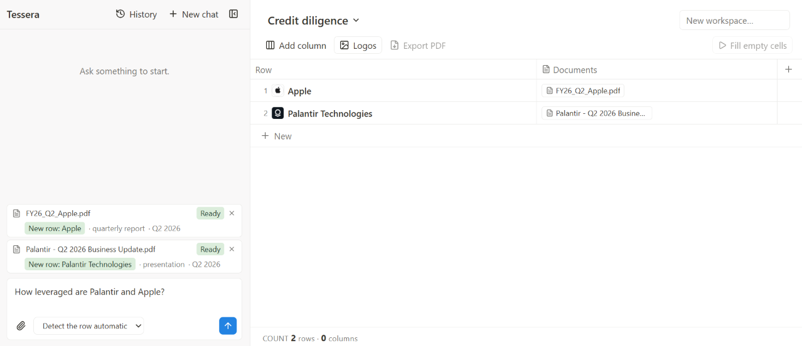
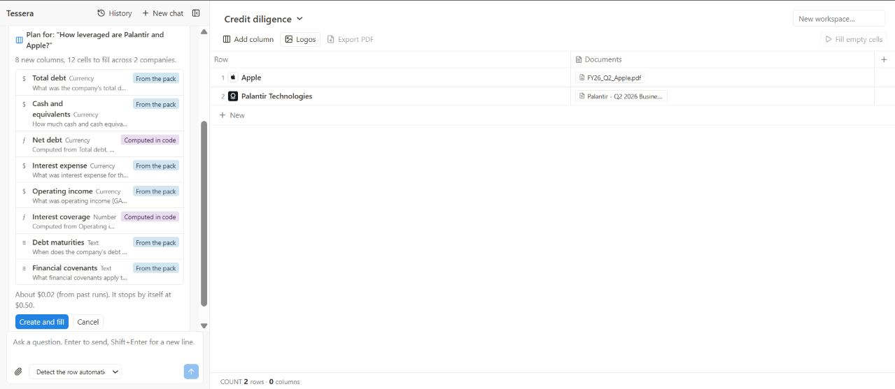
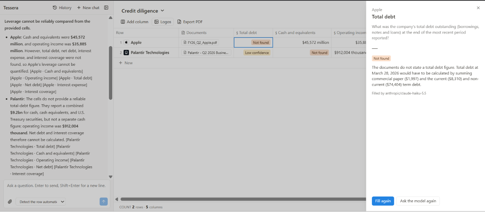
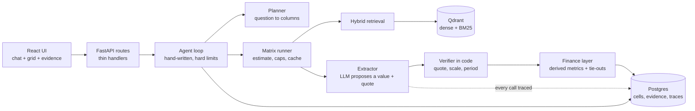

# Tessera

A financial research workbench for private equity and credit diligence. Ask a question about public companies and Tessera builds a matrix of **companies x typed questions**, fills every cell from the companies' own filings, and writes the answer from those cells.

Every number is tied to a **verbatim quote** that is checked in code, and it carries its period, units and currency. Derived metrics (net debt, interest coverage) and tie-out checks are computed in code, never by the model. When the documents do not say, the cell says so.



## Why it is not a chatbot over a table

| Rule | How it is enforced |
|---|---|
| Never answer from memory | Cell values come from retrieved document text only. Document text is fenced as data and can never trigger a tool call. |
| Every answer is cited | A quote must appear verbatim in the cited source, or the cell is not `answered`. |
| Numbers carry period, units, currency | Scale (`$1.2B`, `402 million`) is parsed in code. An answer that drops a scale printed in its quote is refused. A period must appear in the text it came from. |
| The model does not do arithmetic | Net debt, interest coverage, margins and growth are computed in code from other cells, and refuse mixed currencies, mixed periods and zero divisors. |
| Checks are shown, not hidden | Tie-outs (such as gross profit = revenue minus cost) run in code and a failure is shown on the cell with the gap. |
| "Not applicable" is not "not found" | They are separate cell statuses and are never merged. |
| Costs are bounded | A cost estimate and a confirmation come before a run. Hard step, time and cost limits apply per turn and per session. |

The pattern throughout: **the model proposes, code decides.**

## How it works

1. **Attach a filing.** Intake identifies the company (name, ticker, domain) and finds or creates its row.
2. **Ask a question.** "How leveraged are Palantir and Apple?" becomes a **plan card**: which columns, which are computed, and what it will cost.

   

3. **Confirm.** Cells are filled with hybrid retrieval (BM25 plus dense vectors, fused with RRF), extraction with quote verification, then computed cells and tie-outs.
4. **Read the answer.** The chat answer is written from the cells, with `[Row · Column]` citations. Click any cell to see its status, reason and verbatim quote.

   

   The `Not found` above is the intended behaviour. Apple's filing never states a total debt figure, and the tool says what would have to be summed instead of inventing a number.

## Architecture



- **Domain pack.** A JSON file of typed columns, applicability rules, derived metrics and tie-out checks ([credit_pe_diligence.json](backend/app/packs/data/credit_pe_diligence.json), 26 columns). A new pack needs no new logic.
- **Agent.** A hand-written loop, with a tool registry of Pydantic-typed tools. Costly or destructive actions (remove a row, overwrite a human-edited cell) are stored as pending actions and run only after the user confirms.
- **Tracing.** One row per LLM call: request id, model, prompt version, tokens in and out, cost, latency, status. Results are cached.
- **Export.** The grid exports to PDF with a Sources appendix.

## Stack

Python 3.14, FastAPI, Pydantic v2, asyncpg and Postgres, Qdrant, fastembed (BM25), LangChain model adapters, OpenRouter, pytest, ruff, mypy. React 19, TypeScript, Vite, Tailwind, TanStack Table, vitest.

## Run it locally

Requirements: Python 3.14 with [uv](https://docs.astral.sh/uv/), Node 20+, Postgres, an OpenRouter key.

```bash
# 1. configure (secrets come only from the environment)
cp .env.example .env          # set OPENROUTER_API_KEY and DATABASE_URL

# 2. database
uv run python -m backend.app.db.migrate

# 3. backend
uv run uvicorn backend.app.main:app --port 8000

# 4. frontend
cd frontend && npm install && npm run dev      # http://localhost:5173
```

Vectors live in a local folder (`data/qdrant`) unless `QDRANT_URL` is set.

## Tests

```bash
uv run pytest backend/tests/test_finance_derive.py     # run a file at a time
cd frontend && npm test
```

The full backend suite is slow (over ten minutes), so run the files for the area you changed.

## Evaluation

Not published yet. This project reports only numbers that its eval harness produced, so there are no accuracy figures here. Harnesses exist for routing, retrieval, parsing and extraction under [eval/](eval/). The finance eval over real SEC filings is the next step, and its results and a written failure analysis will go in this section.

## Known limits

- A period must be printed in the retrieved text for the cell to carry it.
- Where a filing combines cash with Treasuries, the cash cell is `not found` rather than a guess.
- Wording of model answers varies from run to run. Values, quotes and checks do not come from that wording.
- Tool steps shown while the agent works are not kept after a page reload.

## Status and roadmap

Built: chat with context management, ingestion, hybrid retrieval, verified extraction, matrix runs with estimate and caps, result cache, tracing, intake, agent loop with confirmations, domain pack, plan card, finance layer, grid UI, PDF export, chat history.

Next: finance eval over real filings, one-command Docker setup, Excel export. Possible later: EDGAR ingest by ticker, bank and fintech packs, a CI gate on the eval.

## Data

Evaluated on public SEC filings (EDGAR). Documents you upload stay in your own database and are sent only to the model provider you configure.
